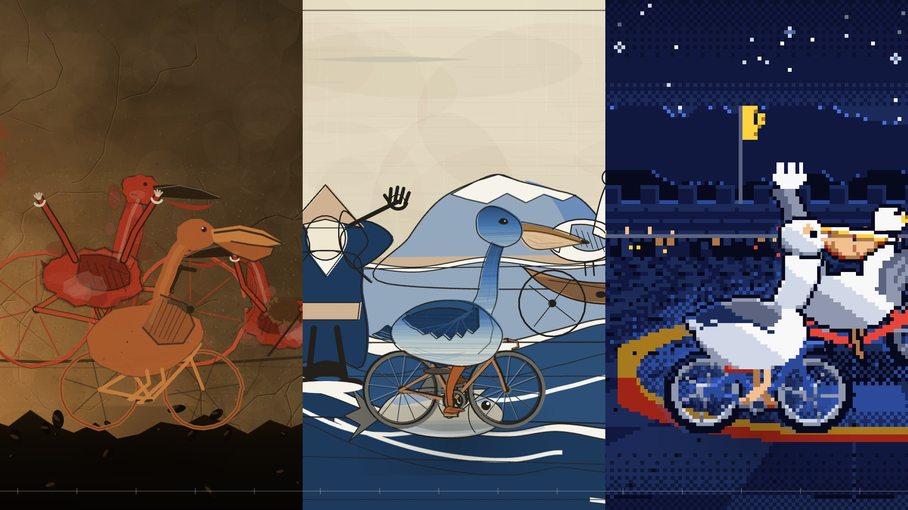

# 《鹈鹕测试》The Pelican Test · 时光长卷



> 一只白鹈鹕骑着自行车，从四万年前的洞窟一路骑到 2025 年的短视频；每穿过一道接缝，它就被重新画成那个年代的画法。
> 一本正经的博物馆冷面笑话。**全片由 JavaScript 用 p5.js + p5.brush 逐帧画成，没有任何外部图片、影片素材。**

▶ 成片见 **[Releases](../../releases)**：1080p 72.4 MB、720p 19.7 MB、封面，附 SHA-256。本地渲染产物在 `out/final.mp4` 与 `out/frames_v2/`，`out/` 不进版本库。

## 内容
82 秒、1920×1080、24 fps，1968 帧。全片是一卷**连续的时光长卷**，一次也不剪切：序、15 个年代、后记共 17 张画心
横向相接，世界宽 17 × 1920 = 32640 px，镜头一路向右卷，在每张画心中央放慢、在接缝处加速掠过。

左上角是年代，右下角是一张博物馆馆藏标签卡（藏品名、材质、尺寸、编号，以及一句冷笑话），底部一条长卷进度尺。
接缝经过画面中央时标签卡会淡掉——那时没有“一幅画”可以标注。

| # | 年代 | 画法 | 时间 | 档案 |
|---|---|---|---|---|
| 0 | 序 | 铅笔素描的题签「鹈鹕骑车图」与朱印 | 0–5 s | `prologue.js` |
| 1 | 约 40,000 BCE | 洞穴壁画（红赭、火把光、喷印手掌） | 5–11 s | `cave.js` |
| 2 | 约 1300 BCE | 古埃及墓室壁画 | 11–17 s | `egypt.js` |
| 3 | 约 500 BCE | 希腊黑像式陶瓶 | 17–23 s | `greece.js` |
| 4 | 79 CE | 庞贝马赛克 | 23–27 s | `pompeii.js` |
| 5 | 约 1000 | 北宋水墨 | 27–31 s | `song.js` |
| 6 | 约 1250 | 中世纪泥金手抄本 | 31–35 s | `medieval.js` |
| 7 | 1498 | 文艺复兴湿壁画的 sinopia 底稿 | 35–39 s | `supper.js` |
| 8 | 1831 | 浮世绘木版 | 39–43 s | `ukiyo.js` |
| 9 | 1889 | 梵高星夜（流场笔触） | 43–47 s | `starry.js` |
| 10 | 1931 | 达利超现实 | 47–51 s | `dali.js` |
| 11 | 1962 | 波普艺术（四色印版＋网点） | 51–55 s | `popart.js` |
| 12 | 1985 | synthwave / VHS | 55–59 s | `synth.js` |
| 13 | 1991 | 16-bit 像素格斗 | 59–63 s | `pixel.js` |
| 14 | 2006 | Windows XP | 63–67 s | `winxp.js` |
| 15 | 2025 | TikTok 霓虹 | 67–73 s | `tiktok.js` |
| 16 | 后记 | 铅笔跋文与「完」印 | 73–82 s | `epilogue.js` |

画心在 `src/scenes/`，画法在 `src/skins/`，两边同名；序与后记共用 `sketch.js`。

声音全部程序合成（`tools/audio.py`，numpy）：每个年代换一种乐器演奏同一个动机，接缝处一声过渡，底下铺一条 drone。

## 接缝就是蒙版
这是全片唯一的机关。鹈鹕固定踩在画面 x = 742 的位置，世界从它脚下流过；它此刻属于哪一代，
取决于车轮底下压着的是哪张画心。

换画发生在**接缝扫过鹈鹕**的那一瞬（第一次是 t ≈ 3.8 s）：`src/rider.js` 把上一代和这一代的画法
分别画进两张 1024×768 图层，各自用 `destination-in` 沿接缝的局部 x 切一刀，再叠起来。
于是接缝左边还是石墨，右边已经是红赭——它是在穿越接缝的瞬间被重新画成那个年代的。

## 架构
- `src/scroll.js` 长卷引擎：镜头、画心烘焙、接缝、鹈鹕状态、合成
- `src/rider.js` 那只鹈鹕：两张 1024×768 图层 + 接缝蒙版
- `src/skins/*.js` 16 种画法（`sketch` + 15 个年代），每种只画同一只鸟同一台车
- `src/kit.js` 共用绘图套件（笔刷、排线、图层、烘焙、鹈鹕／自行车骨架）
- `src/hud.js` 年代、馆藏标签卡、底部长卷进度尺
- `src/scenes/*.js` 17 张画心 · `src/beat.js` 节拍 · `src/main.js` 进入点 `renderAt(t)` · `src/loader.js` 载入顺序
- `briefs/*.md` 15 份各年代美术简报 · `SKINS.md` 画法契约 · `STYLE.md` 全片美术规格
- `tools/` 截图、接触表、逐帧渲染、ffmpeg 合成、声音合成 · `vendor/` p5.min.js / p5.brush.js
- 制作方式：先写共用套件与契约，再平行派 15 个 AI 子代理各做一个年代，逐帧看图和改。

### 一帧是怎么画出来的
1. 铺底：全画面贴一张纸纹，画心边缘永远不会露出纯色。
2. 对每个在画面内的画心：烘焙进 framebuffer，场景的 2D 文字画进图层一起合成——文字因此跟着画心卷动。
3. 接缝：左侧渐暗 + 一道金色细线。
4. 鹈鹕：两张图层分别画上一代与这一代，沿接缝切开再叠。
5. HUD：年代、标签卡、进度尺画在一个 2D 图层上整体淡入淡出。

## 自己重跑
需要 Node 20+、ffmpeg、Python 3（numpy）；Puppeteer 会自带 Chrome。

```bash
npm install

# 看某一刻的画面
node tools/shot.mjs --times 20,35.5 --outdir out/shots/check --jpeg

# 单独看一张画心（略过长卷）
node tools/shot.mjs --scene cave --times 8 --outdir out/shots/cave

# 单独看一种画法（放大 1.75×，纸上）
node tools/shot.mjs --skin popart --times 0 --outdir out/shots/skin_popart --jpeg

# 全片渲染（7 个 worker）
node tools/render.mjs --dur 82 --workers 7 --outdir out/frames_v2

# 只重算一段帧（改过某一张画心之后）
node tools/render.mjs --dur 82 --workers 1 --shards 1 --from 840 --to 940 --outdir out/frames_v2

# 声音与合成
python tools/audio.py
node tools/encode.mjs --frames out/frames_v2 --audio out/audio/mix.wav --out out/final.mp4
```

想做自己的版本？[docs/PROMPT.md](docs/PROMPT.md) 是从零复现本片的完整提示词。

## 技术要点（踩过的坑）
- p5 2.x 的 `bezierVertex()` **一次只吃一个点**（六参数的旧写法会让 `evaluateCubicBezier` 拿到 undefined）。
- p5 2.x 的 WEBGL **不能用 CSS 字型名**（只有载入的 TTF 有字形），所以全片文字走 `K.txt()` 的 2D 图层再合成。
- p5 2.x 的 `redraw()` 是异步的；`window.__renderAt()` 回传 Promise，截图前必须 await。
- WEBGL 画布原点在中心；`p.image()` 的 (x, y) 仍是左上角语意；framebuffer 原点在其中心。
- `p.tint()` 会污染后续的 2D 图层合成（文字整个 180° 翻转）——本片不使用 tint。
- 场景若呼叫 `p.background()` 会盖掉隔壁画心——所以每张画心必须烘焙进自己的 framebuffer。
- `K.hand()` 的手指要**近乎平行**；早期用扇形展开，远看像一副爪套。
- `K.wrapText()` 量测用的是 2D context 当下的字型，换行前必须先设好 `drawingContext.font`，否则中文标签会溢出卡片。

## 关于「鹈鹕骑自行车」
2024 年 10 月，Simon Willison 拿「画一只骑自行车的鹈鹕」当非正式的模型测试：训练数据里大概不存在这种东西，
模型没法照抄，只能真的把一只鸟拼到一台车上。这个梗后来成了观察多模态与代码生成能力的一个小型基准。

本片是它的手写对照：不用模型，用 16 种真实存在过的绘画技法，让同一只鸟在四万年里被反复重画。
本作未使用任何该基准的产出。

## 成品
`out/final.mp4` — H.264 High@4.1 / yuv420p / CRF 17，AAC-LC 48 kHz 立体声 192 kbps。

| | |
|---|---|
| 尺寸 | 1920×1080（16:9） |
| 帧率 | 24 fps，1968 帧 |
| 时长 | 82.000 s |
| 大小 | 72.4 MB（7.1 Mbps） |
| 响度 | −16.6 LUFS，真峰值 −4.0 dBTP |
| 头尾 | 0.8 s 淡入、1.1 s 淡出 |

逐帧 PNG：`out/frames_v2/`（1968 张）。声音：`out/audio/mix.wav`（mono 48 kHz，编码时上混立体声）。

## 授权
- **代码**：MIT，见 [LICENSE](LICENSE)。
- **影片、封面、渲染帧与音频**：**保留所有权利**，禁止转载／二次上传，见 [LICENSE-MEDIA.md](LICENSE-MEDIA.md)。
- 第三方组件、字体与致敬声明：[NOTICE.md](NOTICE.md)。
